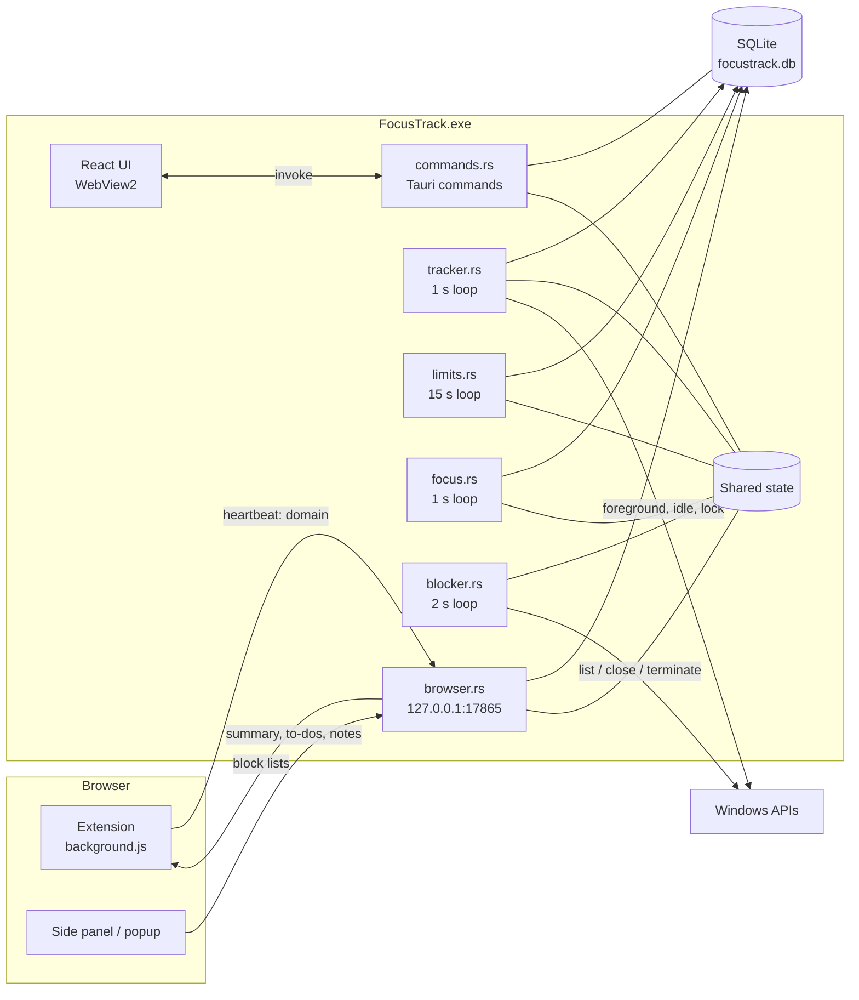

# Architecture

FocusTrack is a [Tauri 2](https://tauri.app) desktop app: a Rust backend that tracks and enforces, a React
UI in a WebView2 window, a local SQLite database, and a browser extension that reports the active website.



## Repository layout

```
src/                    React + TypeScript UI (Vite, Tailwind, Recharts)
  pages/                one file per screen
  components/           shared UI, charts, goals, notes, session (focus/study) widgets
  lib/api.ts            typed wrappers over Tauri commands (sample data outside Tauri)
  lib/mock.ts           sample data for `npm run dev` in a normal browser
src-tauri/              Rust backend
  src/lib.rs            app setup: plugins, tray, threads, command registration
  src/*.rs              modules described below
  capabilities/         Tauri permission sets
  tauri.conf.json       window, bundle and build config
extension/              Manifest V3 browser extension (no build step)
docs/                   requirements, roadmap, audit
.github/                CI/CD workflows, issue and PR templates
```

## Backend modules

| Module | Responsibility |
|---|---|
| `tracker.rs` | 1-second loop. Records the foreground app (`usage_sessions`), the active website when a browser is in front (`website_sessions`), and idle time (`idle_periods`). Handles lock, pause, sleep (wall-clock jumps) and midnight splits. Open rows are flushed every 5 s and updated in place, so a crash loses at most a few seconds and never duplicates. OS access goes through a `Probe` trait so tests can fake it. |
| `platform.rs` | Win32 calls via `windows-sys`: foreground window → process → exe path (incl. UWP hosts), `GetLastInputInfo`, lock detection, file descriptions, process listing, `WM_CLOSE`, `TerminateProcess`. |
| `browser.rs` | `tiny_http` server on `127.0.0.1:17865` for the extension: `POST /v1/heartbeat`, `GET /v1/summary`, `POST /v1/goals/toggle`, `POST /v1/notes`. Rejects non-extension origins, foreign `Host` headers and requests without `X-FocusTrack`. |
| `limits.rs` | 15-second loop. Computes today's usage per limit, applies the action (notify / warn-then-block / block), maintains block lists, sends limit, goal, break and reminder notifications (once per day each). |
| `blocker.rs` | 2-second loop while anything is blocked. Asks blocked apps to close (`WM_CLOSE`), terminates after 8 s, re-closes on reopen. Never touches protected Windows components, anything under `%WINDIR%`, Explorer, Task Manager, terminals or FocusTrack. |
| `focus.rs` | Focus/study session engine: Pomodoro sequencing, rows in `focus_sessions`, applying a profile's block lists for the whole session, early-end rules (allow / confirm / strict). |
| `profiles.rs` | Blocking profiles and resolving them to concrete app/site lists (`block` or `allow_only`). |
| `goals.rs` | Goals and today's progress (measured and custom to-dos). |
| `insights.rs` | Rule-based, local insights. |
| `notes.rs` | Notes, notebooks and study resources. |
| `installed.rs` | Installed-app discovery from Start Menu shortcuts (`.lnk` parser) and the installed-programs registry. |
| `analytics.rs` | Read-side aggregation: totals, per-day, per-app/site, categories, hours, heatmap. |
| `categories.rs` | Built-in categories and default exe/domain → category maps; browser detection. |
| `db.rs` | Connection setup (WAL), schema migrations (`PRAGMA user_version`), settings, writes. |
| `commands.rs` | Tauri commands used by the UI. Validates input. |

### Threads and shared state

Each loop runs on its own thread with its **own SQLite connection** (WAL mode + busy timeout). They share an
`Arc<tracker::Shared>` holding atomics (paused, idle threshold, settings flags), the live status, the latest
browser reports, block lists and the active focus session. The UI's commands use one more connection behind
a mutex.

### Data model (schema v4)

`categories`, `applications`, `usage_sessions`, `idle_periods`, `websites`, `website_sessions`,
`usage_limits`, `limit_overrides`, `sent_notifications`, `focus_sessions`, `goals`, `goal_checks`,
`block_profiles`, `notes`, `study_resources`, `user_settings`. Times are local `YYYY-MM-DD HH:MM:SS` text with
a separate `day` column; sessions never span midnight. Migrations are additive and run on every connection
open; add a new `if version < N` block for schema changes.

## Frontend

React 18 + TypeScript (strict), Tailwind 4, Recharts, lucide icons. Pages poll the backend with `useLoad`
(pauses while the window is hidden). `lib/api.ts` is the only place that calls `invoke`; outside Tauri it
returns sample data from `lib/mock.ts`, so UI work doesn't need Rust.

## Browser extension

Plain MV3 JavaScript, no build step. `background.js` sends the active tab's domain on tab/window changes and
every 30 s, and redirects tabs that are blocked (limit reached, focus block list, or not on an allow-only
list) to `blocked.html`. `sidepanel.html` and `popup.html` render widgets from `usage.js` using the summary
API; widget choice/order is kept in `chrome.storage.sync`.

## Security model

- The local API is reachable only from this machine and only from browser extensions (or local processes —
  see [SECURITY.md](SECURITY.md) for known limitations).
- No network access except the local API; no telemetry.
- The UI only loads bundled code. Commands validate their input; all SQL is parameterised.
- Blocking is designed to be escapable (Task Manager and FocusTrack are never blocked) so users can't lock
  themselves out of their own PC.

## Build & release

- CI (`.github/workflows/ci.yml`): TypeScript build, `cargo fmt --check`, `cargo clippy -D warnings`,
  `cargo test` on Windows, extension syntax checks, dependency audits.
- Release (`.github/workflows/release.yml`): pushing a `vX.Y.Z` tag builds the NSIS and MSI installers on
  Windows, packages the extension, writes SHA-256 checksums, and publishes a GitHub Release.
