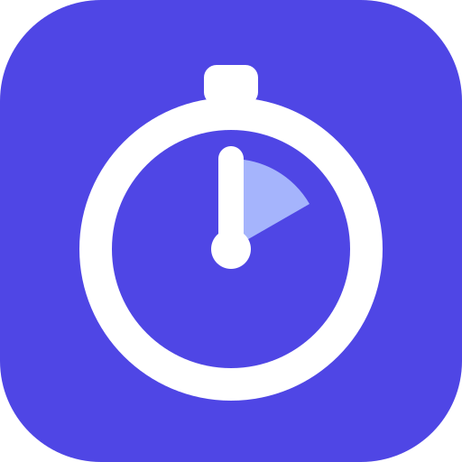

<div align="center">



# FocusTrack

**Screen time, focus and digital wellbeing for Windows — private, local and open source.**

[](https://github.com/Kamesh2212/focustrack/actions/workflows/ci.yml)
[](https://github.com/Kamesh2212/focustrack/releases/latest)
[](LICENSE)

</div>

FocusTrack shows where your time goes on your PC and helps you take it back: daily and weekly reports,
limits that actually block distracting apps and websites, focus and study sessions, goals, and notes.
It's built for anyone who wants to cut back on social media, gaming or streaming, and get more of the
work that matters done.

Everything stays on your computer. FocusTrack never records keystrokes, screenshots, window contents,
passwords, full URLs or page content.

## Features

- **Automatic tracking** of the app in front and, with the browser extension, the website in the active tab.
  Idle, locked and sleeping time are handled correctly.
- **Dashboard** you can customise: screen time, goals and to-dos, focus session, app and website usage,
  productivity summary, limits, quick note, insights.
- **Reports**: daily, weekly, monthly and custom ranges; categories; productive vs distracting time; activity
  heatmap; history with CSV export.
- **Usage limits** for apps and websites: notify only, warn then block, or block at the limit, with a
  configurable number of "+15 min" extensions per day.
- **Focus Mode & Study Mode**: Pomodoro or custom sessions with blocking profiles (Study Mode, Work Mode, Deep
  Focus allow-only, or your own). See exactly what will be blocked before you start; access returns when the
  session ends.
- **Daily goals**: screen-time caps, category targets ("Study 3 hours"), focus sessions, and to-dos you tick
  off, with an evening reminder.
- **Notes** in notebooks, linked to the session you wrote them in, plus saved study resources.
- **Browser side panel** (Chrome, Edge, Brave; Firefox sidebar) with the widgets you choose. Your own new tab
  page stays untouched.
- **Insights** in plain language: biggest changes this week, busiest hours, focus streaks.

## Install

1. Go to the [latest release](https://github.com/Kamesh2212/focustrack/releases/latest) and download
   **`FocusTrack-<version>-windows-x64.zip`**.
2. Unzip it and run **`FocusTrack_<version>_x64-setup.exe`**.
   The installer isn't code-signed yet, so Windows SmartScreen may say "Windows protected your PC" —
   choose **More info → Run anyway**. You can check the download against `SHA256SUMS.txt`.
3. **Browser extension** (for website tracking, website limits and the side panel):
   - Chrome / Edge / Brave: open `chrome://extensions` (`edge://extensions`, `brave://extensions`),
     turn on **Developer mode**, click **Load unpacked**, and choose the `extension` folder from the zip.
   - Firefox: `about:debugging` → **This Firefox** → **Load Temporary Add-on** → `extension/manifest.json`.
4. In FocusTrack → **Settings**, turn on **Start with Windows** so tracking never misses a day.

Requires Windows 10 or 11 (WebView2 is included in Windows 11 and installed automatically on Windows 10).

## Privacy

- Data lives in a local SQLite database: `%APPDATA%\com.focustrack.app\focustrack.db`.
- The browser extension sends only the active tab's **domain** to FocusTrack on `127.0.0.1`, never to the
  internet. Private windows are never reported.
- Pause tracking, delete old data, or clear everything from **Settings**.
- See [SECURITY.md](SECURITY.md) for the security model and known limitations.

## Build from source

Prerequisites: Windows 10/11, [Node.js](https://nodejs.org) 20+, [Rust](https://rustup.rs) (stable, MSVC),
and Visual Studio 2022 Build Tools with **Desktop development with C++**.

```bash
npm install
npm run app:dev      # run the desktop app with hot reload
npm run app:build    # build installers into src-tauri/target/release/bundle
npm run dev          # UI only, in a browser, with sample data (no Rust needed)
```

```bash
cd src-tauri
cargo test                                  # backend tests
cargo clippy --all-targets -- -D warnings   # lints
cargo fmt --check                           # formatting
```

If the build fails with `LNK1104: cannot open file …build_script_build.exe`, your project path is too long
for the MSVC linker. Set a short build directory, e.g. `CARGO_TARGET_DIR=C:\ft-target`.

## Documentation

- [ARCHITECTURE.md](ARCHITECTURE.md): how the app is put together.
- [CONTRIBUTING.md](CONTRIBUTING.md): how to report issues, pick work, branch and open pull requests.
- [docs/ROADMAP.md](docs/ROADMAP.md): what's next, including multi-device sync.
- [docs/AUDIT-1.0.0.md](docs/AUDIT-1.0.0.md): test results and known issues for 1.0.0.
- [docs/SRS.md](docs/SRS.md): the original requirements.
- [CHANGELOG.md](CHANGELOG.md).

## Contributing

Contributions are welcome — bug fixes, features from the roadmap, docs and tests. Start with
[CONTRIBUTING.md](CONTRIBUTING.md) and look for issues labelled
[`good first issue`](https://github.com/Kamesh2212/focustrack/labels/good%20first%20issue).

## License

[MIT](LICENSE)
